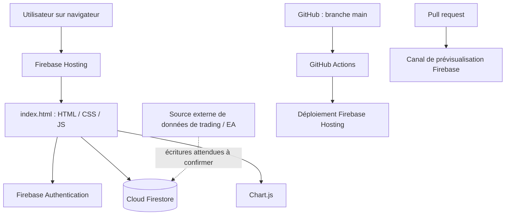

# Architecture technique — DAS Expert Pro Journal

> Documentation établie à partir du code présent dans la branche `main` au moment de l'inspection. Les éléments non présents dans ce dépôt (règles Firestore publiées, configuration de la console Firebase, éventuel Expert Advisor/outil d'import des trades) sont signalés comme externes ou à confirmer.

## 1. Vue d'ensemble

DAS Expert Pro Journal est une application web de suivi de trading et de portefeuilles. Le dépôt contient une application front-end statique, concentrée dans `index.html`, qui communique directement avec Firebase depuis le navigateur.

- **Interface :** HTML, CSS et JavaScript natifs dans un seul fichier.
- **Authentification :** Firebase Authentication (e-mail / mot de passe).
- **Données et temps réel :** Cloud Firestore.
- **Graphiques :** Chart.js 4.4.1.
- **Hébergement :** Firebase Hosting.
- **Automatisation de déploiement :** GitHub Actions.
- **Dépendances chargées par CDN :** Firebase JS SDK 10.8.0, Chart.js et Google Fonts (Manrope).

Aucun serveur applicatif dédié, package manager, dossier source modulaire ou code de Cloud Functions n'apparaît dans l'arborescence actuelle du dépôt.

## 2. Schéma logique



Le navigateur est le client applicatif : il authentifie l'utilisateur, lit les documents Firestore en temps réel et écrit directement les changements autorisés. Le dépôt ne montre pas de couche API intermédiaire.

## 3. Structure du dépôt

```text
.
├── index.html
├── firebase.json
├── .firebaserc
├── .gitignore
├── README.md
└── .github/
    └── workflows/
        ├── firebase-hosting-merge.yml
        └── firebase-hosting-pull-request.yml
```

| Élément | Responsabilité |
|---|---|
| `index.html` | Application complète : écrans, styles, logique métier, appels Firebase et graphiques |
| `firebase.json` | Configuration Firebase Hosting, fichiers ignorés et réécriture vers l'application |
| `.firebaserc` | Association du projet Firebase par défaut |
| `.github/workflows/firebase-hosting-merge.yml` | Déploiement sur le canal live après push sur `main` |
| `.github/workflows/firebase-hosting-pull-request.yml` | Déploiement de prévisualisation lors d'une pull request |
| `.gitignore` | Fichiers exclus du suivi Git |
| `README.md` | Présentation minimale du projet ; à enrichir |

## 4. Front-end

### 4.1 Organisation

Le fichier `index.html` contient :
1. La structure HTML des écrans et formulaires.
2. Une feuille CSS intégrée (thème sombre, cartes, tableaux, responsive).
3. Un script JavaScript ES module qui importe les SDK Firebase.

Les éléments de l'interface sont principalement ciblés par leur identifiant HTML avec une petite fonction utilitaire (`$`). Les événements sont attachés directement aux éléments DOM. Les données en mémoire sont conservées dans des objets JavaScript (comptes, trades, snapshots et abonnements).

### 4.2 Écrans et capacités visibles

- Connexion, création de compte, réinitialisation du mot de passe et vérification de l'adresse e-mail.
- Vue d'ensemble des comptes et indicateurs de performance.
- Gestion administrative des espaces, utilisateurs et portefeuilles.
- Espace investisseur avec capital confié, valeur estimée, performance, drawdown et commission estimée.
- Règles de compte de type prop firm : capital initial, perte journalière, drawdown total et objectif.
- Plan de trading avec brouillon, soumission, demande de correction, refus, approbation/verrouillage, déverrouillage motivé et historique des versions.
- Positions ouvertes, trades clôturés, statistiques, résultats mensuels et résultats par état émotionnel.
- Qualification des trades (setup, respect du plan, émotion, notes).
- Export CSV des trades affichés.
- Messagerie : annonces, canaux communautaires et conversations privées.

### 4.3 Calculs et visualisations

Les indicateurs sont calculés côté navigateur à partir des trades clôturés et des données de compte : PnL, taux de réussite, profit factor, drawdown, séries gagnantes/perdantes, espérance par trade, gains/pertes moyens, conformité déclarée au plan et résultats par mois/émotion.

Chart.js rend les courbes de capital/équité et les histogrammes. Pour un compte individuel, la courbe peut utiliser les snapshots temps réel ; sinon, elle est reconstruite à partir des trades clôturés.

## 5. Authentification, profils et autorisations applicatives

Firebase Authentication utilise les comptes e-mail / mot de passe. L'application observe l'état de connexion avec `onAuthStateChanged`, crée/met à jour un document utilisateur et affiche les écrans selon le profil.

Les types d'espaces déclarés dans le code sont :
- `trader` : trader de firme ;
- `portfolio` : portefeuille client ;
- `learner` : apprenant ;
- `investor` : investisseur.

Les portefeuilles associent notamment un investisseur (`investorUid`) et un trader gestionnaire (`traderUid`). L'interface prévoit une vue en lecture seule pour certains profils et une console d'administration.

**Point de sécurité important :** la détection du compte administrateur est effectuée dans le JavaScript du navigateur à partir de l'adresse e-mail et de l'état de vérification. Cette vérification côté client ne constitue pas une protection suffisante. Les droits réels doivent impérativement être appliqués par les règles de sécurité Firestore (et, si nécessaire, par une logique serveur de confiance). Ne jamais considérer un bouton masqué ou une variable JavaScript comme une autorisation de sécurité.

## 6. Modèle de données Firestore observé dans le code

Les chemins suivants sont construits ou écoutés par le front-end. Les champs cités sont ceux dont l'utilisation est visible dans le code ; ils ne constituent pas un schéma exhaustif validé côté base.

| Chemin Firestore | Usage |
|---|---|
| `users/{uid}` | Profil technique : e-mail et date de dernière connexion |
| `users/{uid}/accounts/{accountId}` | Compte de trading : solde, équité, capital initial, statut/horodatage, positions |
| `users/{uid}/accounts/{accountId}/trades/{tradeId}` | Trades clôturés : date, heure de clôture, actif, sens, taille, PnL, R/R, setup, respect du plan, émotion, notes |
| `users/{uid}/accounts/{accountId}/snapshots/{snapshotId}` | Historique des valeurs de solde/équité horodatées |
| `spaces/{uid}` | Type et libellé de l'espace, statut actif, liens investisseur/trader et paramètres du portefeuille |
| `plans/{uid}/versions/{version}` | Versions du plan de trading, contenu, statut et décisions |
| `plans/{uid}/unlocks/{unlockId}` | Journal des déverrouillages de plans et motif |
| `config/planTemplate` | Modèle de règles communes du plan de trading |
| `announcements/{announcementId}` | Annonces générales |
| `channels/{kind}/messages/{messageId}` | Messages des canaux par catégorie |
| `dms/{uid}` et `dms/{uid}/messages/{messageId}` | Conversations privées et messages |

### 6.1 Champs de portefeuille repérés

Le formulaire d'administration utilise notamment : `kind`, `label`, `email`, `active`, `investorUid`, `traderUid`, `investorEmail`, `capital`, `startBal`, `formula`, `clientPct`, `tMin`, `tMax`, `ddMax`, `hwm` et `startDate`.

### 6.2 Plan de trading

Les règles communes et personnalisées comprennent notamment : risque par trade, perte maximale par jour/semaine, nombre maximal de trades par jour, taille de lot maximale, arrêt après une série de pertes, R/R minimum, actifs/configurations autorisés et états émotionnels interdits. Les statuts visibles sont : brouillon, soumis, corrections demandées, refusé, verrouillé et archivé.

### 6.3 Source des données de trading

L'interface indique que les trades clôturés arrivent automatiquement depuis un EA et lit les positions depuis le document du compte. Cependant, aucun EA, connecteur, endpoint d'ingestion ou code d'écriture externe n'est présent dans ce dépôt. Le mécanisme qui alimente les documents `accounts`, `trades` et `snapshots` reste donc **à documenter séparément**.

## 7. Temps réel et cycle de vie des abonnements

Le front-end utilise principalement les écouteurs Firestore `onSnapshot` :
- liste des utilisateurs et des espaces ;
- comptes de l'utilisateur consulté ;
- trades et snapshots de chaque compte ;
- versions et déverrouillages du plan ;
- modèle de plan ;
- annonces, canaux et messages privés.

Le code conserve les fonctions de désabonnement et les appelle lors d'un changement de vue ou de déconnexion. Le tableau de bord est également rafraîchi périodiquement pour recalculer les indicateurs de présence et les vues.

## 8. Hébergement et livraison continue

### Firebase Hosting

La configuration actuelle utilise `public: "."` et réécrit toutes les routes vers `/index.html`. Les fichiers de configuration, fichiers cachés, dépendances, journaux, documentation Markdown, répertoires de tests/fonctions et fichiers de règles Firestore sont exclus de l'hébergement selon `firebase.json`.

### GitHub Actions

- **Push sur `main` :** le workflow de fusion déclenche le déploiement sur le canal live Firebase Hosting.
- **Pull request :** le workflow de PR crée une prévisualisation, uniquement lorsque la branche source appartient au même dépôt.
- Les workflows utilisent un secret GitHub de compte de service Firebase et le jeton GitHub fourni par Actions. Les valeurs des secrets ne sont pas documentées ici.

## 9. Sécurité et points à vérifier avant production

1. **Règles Firestore :** aucun fichier `firestore.rules` n'apparaît dans l'arborescence actuelle, bien que la configuration Hosting l'exclue explicitement. Vérifier les règles réellement publiées dans Firebase Console. Elles doivent contrôler chaque lecture/écriture par UID, rôle, relation investisseur/trader et statut.
2. **Rôle administrateur :** déplacer la décision d'autorisation vers un mécanisme de confiance (par exemple claims personnalisés gérés côté serveur) et faire respecter ce rôle dans les règles Firestore. L'adresse e-mail codée dans le front-end est visible publiquement.
3. **Création d'utilisateurs :** le code crée un second contexte Firebase Authentication pour créer un compte depuis la console admin. Vérifier que ce flux ne remplace pas la session principale et que les autorisations sont strictement contrôlées.
4. **Validation des données :** valider les types, plages numériques, horodatages et champs attendus dans les règles ou un service de confiance ; ne pas se fier uniquement aux formulaires du navigateur.
5. **Dépendances CDN :** documenter et surveiller les versions des SDK et bibliothèques chargés depuis des CDN.
6. **Données personnelles et financières :** limiter les accès, éviter les journaux contenant des données sensibles et définir une politique de conservation/sauvegarde.
7. **Exports CSV :** le code neutralise les préfixes de formules usuels lors de l'export ; conserver cette protection lors de toute évolution.
8. **Tests :** aucun dossier ou workflow de tests automatisés n'est visible dans ce dépôt. Ajouter des tests pour les calculs de performance, droits d'accès, règles de plans et exports.

Cette liste est un examen statique du dépôt, pas un audit de la configuration Firebase déployée ni un test d'intrusion.

## 10. Limites actuelles et évolutions recommandées

- **Monolithe front-end :** découper progressivement `index.html` en modules (authentification, accès aux données, calculs métier, administration, plans, messagerie et composants UI).
- **Schéma Firestore :** formaliser les interfaces/types de documents et les règles de validation.
- **Ingestion EA :** documenter le protocole, l'identité du producteur, les champs transmis, la fréquence et le traitement des doublons.
- **Environnements :** séparer développement, préproduction et production avec projets Firebase distincts.
- **Qualité :** ajouter tests unitaires des calculs, tests des règles Firestore avec Firebase Emulator Suite et vérifications automatiques dans GitHub Actions.
- **Documentation opératoire :** compléter avec les procédures de configuration Firebase, déploiement, restauration et gestion des comptes.

## 11. Procédures utiles

### Déployer une modification

1. Créer une branche de travail depuis `main`.
2. Modifier et tester l'application dans un environnement de développement.
3. Ouvrir une pull request et vérifier la prévisualisation Firebase.
4. Fusionner dans `main) après revue : le workflow de déploiement live se déclenche.
5. Vérifier l'application en production et les journaux Firebase/GitHub Actions.

### Informations nécessaires pour compléter la documentation

- Le contenu et l'état des règles Firestore effectivement publiées.
- La configuration des méthodes de connexion Firebase et des domaines autorisés.
- Le code ou le protocole de l'EA / service qui envoie les données de trading.
- Les index Firestore, sauvegardes, alertes et paramètres de facturation réellement configurés.
- Les rôles et permissions métier attendus pour chaque type d'utilisateur.

---

**Référence du code inspecté :** branche `main`, fichier principal `index.html`, configuration `firebase.json`, workflows `.github/workflows/`. Toute modification ultérieure du code doit être répercutée dans cette documentation.
